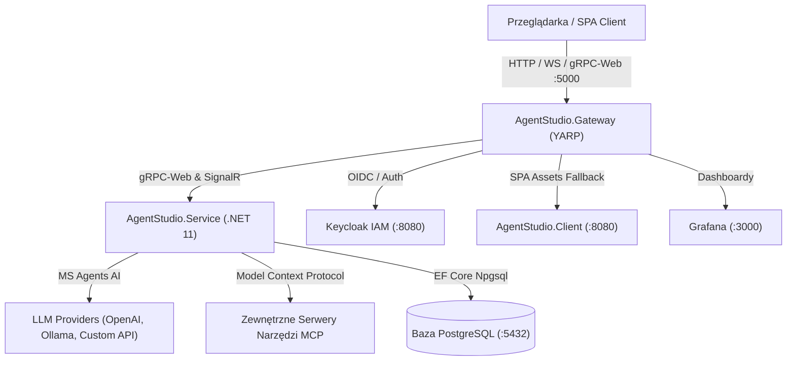

# AI Agent Studio – Wizualny Kreator i Orkiestrator Agentów AI


---

## 📌 O Projekcie

**AI Agent Studio** to nowoczesna platforma oparta na architekturze mikroserwisowej, umożliwiająca wizualne projektowanie, konfigurowanie i uruchamianie autonomicznych oraz wieloagentowych systemów sztucznej inteligencji.

Głównym założeniem systemu jest pełna separacja warstwy prezentacji od logiki wykonawczej:
* Użytkownik za pomocą interfejsu graficznego typu *node-based* (**VueFlow**) buduje przepływy pracy agentów metodą drag-and-drop, definiuje ich zachowanie, dobiera modele LLM oraz podpina zewnętrzne narzędzia z internetu za pomocą protokołu **Model Context Protocol (MCP)**.
* Cała komunikacja przeglądarki z systemem przepływa przez bramkę **Frontend Gateway (YARP Reverse Proxy)** na wspólnym porcie `:5000`.
* Egzekucja agentów odbywa się w wysoko wydajnym środowisku backendowym **.NET 11** z wykorzystaniem ekosystemu **Microsoft Agents AI** (`Microsoft.Agents.AI`) oraz klienta MCP SDK.



---

## 🚀 Główne Funkcjonalności

1. **Wizualny Kreator Przepływów (VueFlow):**
   * Projektowanie architektury agentów oraz ich wzajemnych relacji metodą drag-and-drop.
   * Obsługa 5 dedykowanych węzłów wykonawczych (**Węzeł Agenta**, **Węzeł Modelu LLM**, **Węzeł Promptu Systemowego**, **Węzeł Konektora MCP**, **Węzeł Umiejętności / Skill**) oraz węzłów pomocniczych (**Notatka / Sticky Note**, **Etykieta / Label**).
2. **Elastyczne Podłączanie Modeli AI:**
   * Wsparcie dla chmurowych dostawców (**OpenAI**: `gpt-4o`, `gpt-4o-mini`, itp. oraz **Google Gemini**: `gemini-3.5-flash-lite`, `gemini-1.5-pro`).
   * Pełne wsparcie dla modeli lokalnych (**Ollama**: `gemma3:12b`, `llama3.2`, `mistral`, `deepseek-r1`) bez konieczności ponoszenia kosztów API.
   * Wsparcie dla niestandardowych endpointów zgodnych z OpenAI API (vLLM, LM Studio, Azure OpenAI).
3. **Integracja z MCP (Model Context Protocol) i Autonomiczna Pętla ReAct:**
   * Dynamiczne podłączanie zewnętrznych serwerów MCP (HTTP / SSE Transport).
   * Wbudowane narzędzia MCP (`builtin://tools`): kalkulator matematyczny (`calculate_expression`), czas systemowy (`get_current_time`), diagnostyka środowiska (`get_system_info`), wyszukiwarka internetowa i pobieranie stron (`search_web`, `fetch_page`).
   * Automatyczna pętla decyzyjna **ReAct (Reasoning + Acting)** z detekcją wywołań narzędzi `TOOL_CALL`, zabezpieczająca modele nieposiadające natywnego wsparcia dla OpenAI function-calling (np. `gemma3:12b` czy wybrane modele Gemini).
4. **Wsparcie dla Standardu Microsoft Agent Skills (`SKILL.md`):**
   * Integracja ze standardem Microsoft Agent Skills – możliwość definiowania modularnych umiejętności z instrukcjami domenowymi w plikach `SKILL.md`.
   * Automatyczne mapowanie dołączonych węzłów umiejętności do agentów za pośrednictwem `AgentSkillsProvider`.
5. **Wieloagentowa Orkiestracja i Szablony Przepływów:**
   * Sortowanie topologiczne grafu krawędzi (`Agent 1 -> Agent 2`) z automatycznym przekazywaniem wyników i zmiennymi szablonowymi (`{{input}}`, `{{query}}`).
   * Wbudowane szablony demonstracyjne z automatycznym seedowaniem (m.in. Multi-Agent Research, Gemini Assistant, MCP Calculator & Diagnostics).
6. **Wysokowydajny gRPC-Web & Real-Time SignalR:**
   * Silnie typowane kontrakty Protocol Buffers (`agent_node.proto`).
   * Zapis, odczyt i usuwanie konfiguracji węzłów oraz krawędzi grafu przez gRPC-Web.
   * Asynchroniczne strumieniowanie logów egzekucji agenta krok po kroku oraz odpowiedzi AI na żywo do panelu konsoli frontendu.
7. **Centralna Bramka YARP (Frontend Gateway):**
   * Jeden port wejściowy `:5000` obsługujący gRPC-Web, SignalR (WebSockets), Keycloak, metryki OpenTelemetry (`/metrics`, `/api/telemetry`) i pliki SPA.
   * Całkowita eliminacja problemów z CORS i zróżnicowanymi portami.
8. **Pełne Bezpieczeństwo, Tożsamość (IAM) i Telemetria:**
   * Centralne zarządzanie tożsamością z użyciem Keycloak (realm `agent-studio`, klient OIDC `portal`).
   * Wbudowana telemetria OpenTelemetry (`AgentStudioTelemetry`) eksportująca metryki w formacie Prometheus (`/metrics`) i JSON (`/api/telemetry`) wraz z automatycznie prowizjonowanym dashboardem w Grafanie (`Deploy/grafana/dashboards/agent-studio-telemetry.json`).

---

## 🛠️ Stos Technologiczny

### Frontend
* **Framework:** Vue 3 (Composition API, `<script setup lang="ts">`, TypeScript)
* **Zarządzanie Stanem:** Pinia (`store.ts`, `notifications.ts`)
* **Architektura:** Top-to-bottom ViewModel (`GlobalViewModel.ts`, `AuthViewModel.ts`)
* **Komponenty UI:** Vuetify 3 (motywy `agentStudioDarkTheme` i `agentStudioLightTheme`)
* **Silnik Grafowy:** VueFlow 1.x (`@vue-flow/core`, `@vue-flow/background`, `@vue-flow/controls`, `@vue-flow/minimap`)
* **Komunikacja:** Protocol Buffers & gRPC-Web (`@protobuf-ts/grpcweb-transport`), SignalR (`@microsoft/signalr`)
* **Powiadomienia:** Centralny store powiadomień i komponent Toast Snackbar
* **Internacjonalizacja & Czas:** `vue-i18n` (słowniki `pl.json`, `en.json`), `luxon`
* **Testy Frontendu:** Vitest + JSDOM (`@vue/test-utils`)

### Gateway & Backend
* **Frontend Gateway:** .NET 11 Web App z **YARP Reverse Proxy** (`Yarp.ReverseProxy 2.3.0`)
* **Rdzeń Serwisu:** .NET 11 (C#), ASP.NET Core
* **Orkiestracja AI:** **Microsoft Agents AI** (`Microsoft.Agents.AI`, `Microsoft.Agents.AI.Workflows`, `Microsoft.Agents.AI.OpenAI`)
* **Integracja MCP:** Model Context Protocol C# SDK (`ModelContextProtocol`, `ModelContextProtocol.Core`)
* **Komunikacja:** gRPC, gRPC-Web Middleware, Protobuf (`Grpc.AspNetCore.Web`)
* **Baza Danych:** PostgreSQL 15/16 z Entity Framework Core (`Npgsql.EntityFrameworkCore.PostgreSQL`)
* **Testy Integracyjne:** xUnit, FluentAssertions, `WebApplicationFactory`, **Testcontainers (PostgreSQL)**

### Infrastruktura & CI/CD
* **Konteneryzacja:** Docker & Docker Compose (`compose.yaml`)
* **Tożsamość i Dostęp (IAM):** Keycloak 26+ (automatyczny import realmu `Deploy/keycloak/agent-studio-realm.json`)
* **Monitoring:** Grafana + OpenTelemetry (`/metrics`, `/api/telemetry`)
* **CI/CD:** GitHub Actions (`.github/workflows/ci.yml`) z kompilacją Release, testami integracyjnymi .NET i testami TypeScript

---

## 🧠 Jak działa Kreator Agentów i jak podłączyć Model AI?

### 1. Elementy Składowe Przepływu (Węzły na Kanwie)
Kanwa kreatora pozwala łączyć 5 rodzajów węzłów:
* 🤖 **AI Agent (Czerwony):** Główny węzeł decyzyjny reprezentujący autonomicznego agenta `ChatClientAgent`.
* 🧠 **LLM Model (Niebieski):** Węzeł definiujący model językowy (OpenAI, Ollama, Gemini, Custom API), temperaturę oraz adres API.
* 📝 **System Prompt (Pomarańczowy):** Węzeł wstrzykujący instrukcje bazowe, rolę i zasady postępowania agenta (obsługuje również zmienne szablonowe `{{input}}` i `{{query}}`).
* 🔌 **MCP Connector (Zielony):** Węzeł łączący agenta z serwerem narzędziowym Model Context Protocol (np. wyszukiwarka internetowa, kalkulator, system plików lub wbudowane narzędzia `builtin://tools`).
* 🧩 **Skill Node (Fioletowy):** Węzeł dołączający ustrukturyzowane umiejętności domenowe w standardzie Microsoft Agent Skills (`SKILL.md`).

---

### 2. Sposób 1: Wizualne Podłączenie na Kanwie (Rekomendowane)
1. Kliknij **Add Node -> LLM Model** na pasku narzędzi lub wybierz kartę *LLM Model* z lewego panelu.
2. Kliknij **Add Node -> AI Agent** i umieść go obok modelu.
3. Przeciągnij krawędź z prawego punktu węzła **LLM Model** (uchwyt wyjściowy) do lewego punktu węzła **AI Agent** (uchwyt wejściowy). Możesz też łączyć wielu agentów szeregowo (`Agent 1 -> Agent 2`) w celu przekazywania wyników między agentami.
4. Kliknij węzeł modelu (lub ikonę zębatki ⚙️), aby otworzyć panel inspektora konfiguracji:
   * Wybierz **Provider**: `OpenAI`, `Ollama`, `Gemini` lub `Custom`.
   * Wpisz **Model Name**: np. `gemma3:12b`, `gpt-4o`, `gemini-3.5-flash-lite` lub `llama3.2`.
   * Ustaw **Temperature**: np. `0.7`.
5. Kliknij **Save Changes**. Konfiguracja zostanie natychmiast utrwalona w bazie danych przez gRPC.

---

### 3. Sposób 2: Bezpośrednia Konfiguracja w Węźle Agenta
Każdy węzeł **AI Agent** posiada wbudowaną konfigurację awaryjną:
1. Kliknij bezpośrednio na węzeł Agenta.
2. W panelu inspektora możesz od razu wybrać dostawcę modelu, wpisać prompt systemowy oraz podać URL serwera MCP.
3. Jeśli węzeł Agenta nie ma podłączonego osobnego węzła modelu, silnik automatycznie skorzysta z konfiguracji bezpośredniej lub domyślnej z pliku konfiguracyjnego `appsettings.json` (`Ollama` / `gemma3:12b`).

---

### 4. Konfiguracja Dostawców Modeli (Przykłady)

#### A. OpenAI (Chmura)
* **Provider:** `OpenAI`
* **Model Name:** `gpt-4o`, `gpt-4o-mini`, `o1-mini`
* **Klucz API:** Ustaw zmienną środowiskową `OPENAI_API_KEY=sk-...` lub w `appsettings.json` pod `AiProviders:OpenAI:ApiKey`.
* **Endpoint:** (Domyślnie `https://api.openai.com/v1`)

#### B. Ollama (Lokalnie na Twoim komputerze)
* Uruchom Ollama na komputerze (`ollama run gemma3:12b` lub `ollama run llama3.2`).
* **Provider:** `Ollama`
* **Model Name:** `gemma3:12b`, `llama3.2`, `mistral`, `deepseek-r1`
* **Custom API Endpoint:** `http://localhost:11434` (lub `http://host.docker.internal:11434` w kontenerze).

#### C. Google Gemini (Chmura)
* **Provider:** `Gemini`
* **Model Name:** `gemini-3.5-flash-lite`, `gemini-1.5-pro`
* **Klucz API:** Wprowadź w prawym panelu Inspector dla węzła Modelu (pole *API Key*) lub ustaw zmienną środowiskową `GEMINI_API_KEY` / `GOOGLE_API_KEY`.
* **Endpoint:** (Domyślnie `https://generativelanguage.googleapis.com/v1beta/openai/`)

#### D. Custom API / vLLM / LM Studio / Azure OpenAI
* **Provider:** `Custom`
* **Model Name:** np. `local-model`
* **Custom API Endpoint:** np. `http://localhost:1234/v1`

---

### 5. Uruchomienie Przepływu Agenta
1. Kliknij przycisk **Run Flow...** na pasku narzędzi.
2. W oknie dialogowym wpisz opcjonalne zadanie lub zapytanie wejściowe (np. *„Wyszukaj najnowsze artykuły o AI i przygotuj podsumowanie”*).
3. Kliknij **Execute**.
4. W dolnym panelu konsoli (**Console**) zobaczysz strumieniowane na żywo logi z silnika:
   * Rozpoznanie konfiguracji modelu, krawędzi grafu i promptu,
   * Nawiązanie połączenia z serwerami MCP i podpięcie narzędzi,
   * Wykonanie pętli myślenia agenta w Microsoft Agents AI.
5. W zakładce **Output** pojawi się ostateczna odpowiedź wygenerowana przez Agenta.

---

## 👥 Zespół Projektowy i Podział Zadań

| Członek Zespołu | Role w Projekcie | Główne Obszary Odpowiedzialności |
| :--- | :--- | :--- |
| **Wiktor** | **Project Leader, Head Designer** | • Nadzór nad architekturą systemu i kierunkiem rozwoju projektu.<br>• Projektowanie UI/UX, architektury komponentów oraz przepływów w VueFlow.<br>• Definiowanie standardów kodowania (architektura *top-to-bottom*, separacja ViewModeli i Store'ów).<br>• Projektowanie kontraktów **Protobuf** oraz integracji **gRPC-Web** na styku Frontend – Backend. |
| **Miłosz** | **Head Backend Developer, Microservice Developer** | • Projektowanie i implementacja mikroserwisów w oparciu o **.NET 11**.<br>• Tworzenie usług **gRPC**, obsługa warstwy **gRPC-Web** oraz definicji kontraktów **Protocol Buffers**.<br>• Projektowanie schematów bazy danych **PostgreSQL** oraz warstwy persystencji.<br>• Integracja backendu z serwerem autoryzacji **Keycloak**. |
| **Sebastian** | **Archiwista, Tester, AI Agents Developer, Co-Frontend Developer** | • Implementacja logiki agentów przy użyciu **Microsoft Agents AI** oraz klienta **MCP**.<br>• Wsparcie rozwoju warstwy frontendowej (widoki, komponenty Vuetify, integracja ze Store'ami).<br>• Przygotowanie testów jednostkowych, integracyjnych oraz weryfikacja poprawności działania przepływów.<br>• Prowadzenie dokumentacji technicznej, archiwizacja artefaktów projektowych oraz utrzymanie słowników *locale*. |
| **Maciej** | **Head Frontend Developer, Infrastructure Developer** | • Główna implementacja logiki interfejsu użytkownika w **Vue 3**, **Vuetify**, **VueFlow** oraz klientów **gRPC-Web**.<br>• Budowa i utrzymanie architektury kontenerowej (**Docker**, Docker Compose, **YARP Gateway**).<br>• Konfiguracja i wdrożenie instancji **Keycloak**, **PostgreSQL** oraz stosu monitorującego **Grafana**.<br>• Automatyzacja środowisk deweloperskich i procesów kompilacji plików `.proto`. |

---

## 🗺️ Plan Projektu (Roadmapa)

### Faza 1: Architektura i Infrastruktura Bazowa (Zrealizowane ✅)
- [x] Przygotowanie środowiska uruchomieniowego `docker-compose` (PostgreSQL, Keycloak, Grafana, Gateway).
- [x] Konfiguracja Realmów i klientów OIDC w Keycloak (realm `agent-studio`, klient `portal`).
- [x] Definicja potoków CI/CD budowania serwisów i uruchamiania testów w GitHub Actions (`.github/workflows/ci.yml`).
- [x] Implementacja klienta gRPC-Web oraz integracji logowania Keycloak po stronie frontendu.
- [x] Dodanie magistrali eventów SignalR (`/events`) do asynchronicznego rozgłaszania stanu systemu.
- [x] Inicjalizacja szablonów mikroserwisów w .NET 11 oraz projektu bazowego Vue 3 + Vuetify + Pinia.
- [x] Zdefiniowanie wspólnego repozytorium kontraktów **Protocol Buffers (`agent_node.proto`)** oraz generatorów kodu dla C# i TypeScript.

### Faza 2: Rdzeń Backendowy, Microsoft Agents AI, ReAct MCP i Wieloagentowość (Zrealizowane ✅)
- [x] Implementacja warstwy danych w PostgreSQL z Entity Framework Core (encje węzłów, krawędzi workflow, historii uruchomień).
- [x] Stworzenie mikroserwisu orkiestracji opartego o **Microsoft Agents AI** (`AgentEngine.cs`).
- [x] Implementacja dynamicznego konektora **MCP** (`McpClientService.cs`), pozwalającego na podpinanie narzędzi przez SSE i HTTP.
- [x] Wbudowane narzędzia MCP (`builtin://tools`): kalkulator matematyczny (`calculate_expression`), czas systemowy (`get_current_time`), diagnostyka środowiska (`get_system_info`), wyszukiwarka internetowa i pobieranie stron (`search_web`, `fetch_page`).
- [x] Autonomiczna pętla wnioskowania **ReAct (Reasoning + Acting)** z automatycznym protokołem `TOOL_CALL`, zabezpieczająca modele nieobsługujące natywnego function-calling (np. lokalne modele Ollama `gemma3:12b` czy wybrane modele Gemini).
- [x] Wieloagentowa orkiestracja sekwencyjna (Multi-Agent Chaining) z sortowaniem topologicznym grafu (`Agent 1 -> Agent 2`), przekazywaniem kontekstu między agentami oraz zmiennymi szablonowymi w promptach (`{{input}}`, `{{query}}`, `{{agent_name}}`, `{{flow_id}}`).
- [x] Wsparcie dla chmurowych modeli **Google Gemini** (`gemini-3.5-flash-lite`, `gemini-1.5-pro`) przez endpoint OpenAI-compatible z walidacją kluczy API.
- [x] Automatyczne seedowanie 5 predefiniowanych szablonów przepływów demonstracyjnych w PostgreSQL i InMemory (`WorkflowSeeder.cs`).

### Faza 3: Warstwa Wizualna VueFlow, Standard Microsoft Agent Skills i UI Inspektora (Zrealizowane ✅)
- [x] Stworzenie architektury Store'ów (Pinia) oraz ViewModeli (`GlobalViewModel.ts`) zarządzających stanem kreatora i wywołaniami **gRPC-Web**.
- [x] Centralny moduł klienta gRPC (`src/clients/grpc.ts`) ze wsparciem tokenów Bearer.
- [x] Implementacja kanwy **VueFlow** wraz z niestandardowymi węzłami (Węzeł Agenta, Modelu, Promptu, Konektora MCP, Notatek i Etykiet).
- [x] Wdrożenie węzła **Skill Node** na kanwie VueFlow (`NodeType.Skill`) opartego na oficjalnej specyfikacji **Microsoft Agent Skills** (`SKILL.md`).
- [x] Serwis zarządzania umiejętnościami (`SkillService.cs`) z dedykowanymi endpointami gRPC (`GetSkills`, `SaveSkill`, `DeleteSkill`) i integracją z `AgentSkillsProvider`.
- [x] Nowoczesny prawy panel Inspektora (`AppInspectorDrawer.vue`) umożliwiający konfigurację parametrów modeli, promptów, testowania URL serwerów MCP i przypisywania umiejętności.
- [x] Dolny panel konsoli (`AppBottomPanel.vue`) z podziałem na zakładki: logi zdarzeń na żywo, ostateczny wynik egzekucji oraz historię uruchomień.
- [x] System powiadomień Snackbar/Toasts (`notifications.ts`, `AppNotificationSnackbar.vue`).
- [x] Pełna integracja systemu tłumaczeń (i18n: `pl.json`, `en.json`) oraz formatowania stref czasowych i logów (Luxon).

### Faza 4: Integracja, Bramka YARP, Telemetria, Testy i Odporność CI/CD (Zrealizowane ✅)
- [x] Zbudowanie i skonfigurowanie bramki **Frontend Gateway (YARP Reverse Proxy)** na porcie `:5000`.
- [x] Spinanie warstwy frontendowej z mikroserwisami za pomocą **gRPC-Web** (wywołania unarne zapisu/odczytu oraz strumieniowanie odpowiedzi agentów przez SignalR).
- [x] Utworzenie dedykowanego projektu testowego **`AgentStudio.Service.Tests`** z testami integracyjnymi gRPC, nasłuchiwaniem na magistrali SignalR oraz wsparciem **Testcontainers (PostgreSQL)**.
- [x] Kompletny zestaw **22 testów backendowych** pokrywających API gRPC, walidację FluentValidation, SignalR, telemetrię OpenTelemetry, standard `SKILL.md` i silnik AgentEngine.
- [x] Odporność testów CI/CD na brak lokalnej instancji Ollama (`OllamaTestHelper.cs`): testy wymagające aktywnego modelu Gemma3 w środowisku GitHub Actions przechodzą z informacyjnym ostrzeżeniem (`[WARN]`), eliminując fałszywe błędy pipeline'u.
- [x] Wdrożenie testów frontendowych **Vitest + JSDOM** (`WorkflowE2E.spec.ts`, `NodeConfigDialog.spec.ts`, `grpc.spec.ts`, `notifications.spec.ts`).
- [x] Zintegrowanie automatycznych testów w GitHub Actions workflow.
- [x] Rozbudowa dashboardów diagnostycznych w **Grafanie** w oparciu o metryki OpenTelemetry.

### Faza 5: Zaawansowana Orkiestracja, Narzędzia i Rozwój Produkcyjny (W trakcie / Backlog 📋)
- [ ] **Eksport i Import Przepływów:** Możliwość eksportu grafu do plików JSON/YAML oraz importu gotowych szablonów społeczności.
- [ ] **Węzły Warunkowe i Rozgałęzienia (Router & Conditional Node):** Dynamiczne rozgałęzianie ścieżek wykonania na podstawie klasyfikacji intencji lub reguł logicznych (If/Else).
- [ ] **Pamięć Długoterminowa i RAG (Vector Store Node):** Integracja z bazą wektorową (pgvector / Qdrant) i węzłem bazy wiedzy do odpytywania dokumentów (PDF/TXT/Markdown).
- [ ] **Strumieniowanie Odpowiedzi Token-po-Tokenie (Live Token Streaming):** Real-time streaming generowanego tekstu z modeli LLM bezpośrednio na kanwę i do konsoli za pośrednictwem SignalR/SSE.
- [ ] **Zarządzanie Poświadczeniami Zewnętrznych MCP:** Bezpieczny magazyn kluczy (Vault / Secret Store) dla zewnętrznych serwerów MCP (GitHub, Slack, Jira, Confluence) z autoryzacją OAuth2.
- [ ] **Human-in-the-Loop (Approval Node):** Węzeł zatwierdzania akcji krytycznych przez człowieka przed wykonaniem wrażliwych narzędzi MCP.
- [ ] **Analityka i Optymalizacja Kosztów (Cost & Token Tracker):** Panel monitorowania zużycia tokenów oraz szacunkowych kosztów wywołań komercyjnych modeli AI (OpenAI, Gemini) w Grafanie.

---

## ⚙️ Uruchomienie Środowiska Deweloperskiego

### Wymagania Wstępne
* **Docker** & **Docker Compose**
* **.NET 11 SDK**
* **Node.js** (v22+) & **npm / pnpm**

---

### Szybki Start (Całe Środowisko w Dockerze)

Aby uruchomić wszystkie mikroserwisy (Gateway, Backend Service, Frontend SPA, PostgreSQL, Keycloak, Grafana):

```bash
cd AgentStudio
docker compose up -d --build
```

Po uruchomieniu aplikacja dostępna jest pod adresami:
* 🌐 **AI Agent Studio (Aplikacja SPA przez Gateway):** [http://localhost:5000](http://localhost:5000)
* 🔐 **Keycloak IAM (Logowanie i Zarządzanie Realmami):** [http://localhost:8080](http://localhost:8080) (login: `admin` / hasło: `admin`)
* 📊 **Grafana Telemetria:** [http://localhost:3000](http://localhost:3000) (login: `admin` / hasło: `admin`)
* 🐘 **PostgreSQL:** `localhost:5432` (baza: `agents`, user: `keycloak`, hasło: `keycloak_password`)

---

### Uruchomienie Lokalne (Tryb Developerski)

1. **Uruchomienie baz danych i tożsamości:**
   ```bash
   cd AgentStudio
   docker compose up -d postgres keycloak
   ```

2. **Uruchomienie Backend Service:**
   ```bash
   dotnet run --project AgentStudio.Service
   # Serwis nasłuchuje na http://localhost:5001
   ```

3. **Uruchomienie Frontend Gateway (YARP):**
   ```bash
   dotnet run --project AgentStudio.Gateway
   # Bramka nasłuchuje na http://localhost:5000 i kieruje ruch do serwisu oraz klienta
   ```

4. **Uruchomienie Frontend Dev Server (Vite):**
   ```bash
   cd AgentStudio.Client
   npm install
   npm run dev
   # Interfejs deweloperski na http://localhost:5173
   ```

---

### Uruchamianie Testów

* **Testy integracyjne i jednostkowe backendu (.NET 11 + Testcontainers + SignalR + Ollama):**
  ```bash
  dotnet test AgentStudio/AgentStudio.Service.Tests/AgentStudio.Service.Tests.csproj -c Release --no-build --verbosity normal
  ```
  *(Automatycznie uruchamia 22 testy pokrywające API gRPC, walidację FluentValidation, subskrypcje zdarzeń SignalR, telemetrię OpenTelemetry, standard Microsoft Agent Skills `SKILL.md` oraz wieloagentową orkiestrację silnika AgentEngine. W środowisku GitHub Actions, gdzie lokalny serwer Ollama nie jest uruchomiony, testy wymagające aktywnego modelu Gemma3 przechodzą bezpiecznie z czytelnym ostrzeżeniem `[WARN]`, weryfikując architekturę bez przerywania pipeline'u)*

* **Testy komponentów i E2E frontendu (Vitest + JSDOM):**
  ```bash
  cd AgentStudio/AgentStudio.Client
  npm test
  ```
  *(Automatycznie uruchamia 25 testów weryfikujących tworzenie węzłów, usuwanie powiązań, formularze konfiguracji modeli AI i powiadomienia)*
  ```bash
  cd AgentStudio/AgentStudio.Client
  npm test
  ```
  *(Automatycznie uruchamia 25 testów weryfikujących tworzenie węzłów, usuwanie powiązań, formularze konfiguracji modeli AI i powiadomienia)*
